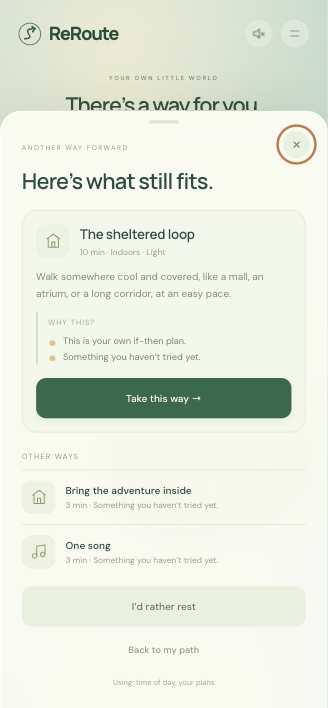
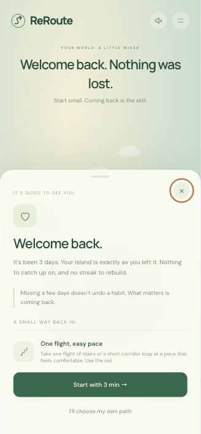
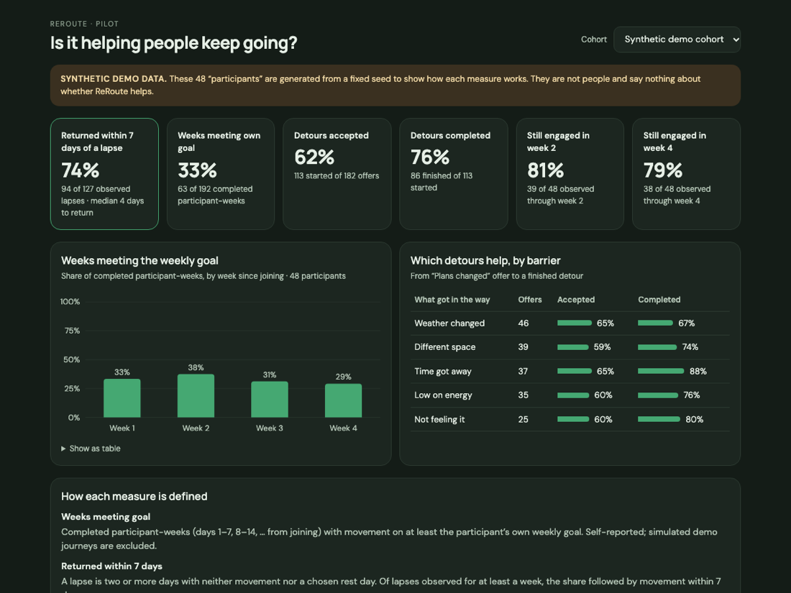

<div align="center">

# ReRoute

### When plans break, find another way. When you drift away, come back.

A mobile-first movement companion that treats setbacks as part of the habit, not the end of it. Choose a small movement break on a living island. When something gets in the way, ReRoute suggests a detour that still fits, using your own if-then plans. When you've been away, it welcomes you back, with no streak to rebuild.

**Future Health Digital Innovation Challenge · Wellbeing · Challenge 09: Sustaining Healthy Behaviors**

[Run it](#run-it) · [3-minute demo](docs/DEMO_SCRIPT.md) · [Evidence](docs/EVIDENCE.md) · [Safety & data](docs/SAFETY.md) · [Pilot plan](docs/PILOT.md)

  

</div>

## The problem

Many people who start moving more stop within weeks, often not because the plan was wrong but because of the first disruption. A meeting overruns, it's 42 °C outside, energy dips, and a missed day turns into a broken streak, then into giving up. Streak-based apps make that moment worse: one lapse resets everything, which is exactly when people quit.

Challenge 09 asks for support that helps people **initiate, sustain and recover** healthy behaviors as circumstances change. ReRoute is built around the *recover* part.

## How ReRoute works

**Choose → Act → Something changes → Adapt or rest → Come back → Discover**

1. **Plan for the bumps (onboarding).** Set a realistic weekly goal and an if-then plan for each common barrier: *"If time gets away from me, I'll take one flight of stairs."*
2. **Pick a path.** Tap a glowing route on the island for a 3–10 minute movement break. A timer runs while you move away from the screen.
3. **Plans changed?** Say what got in the way: time, energy, weather, space, or just not feeling it. A recommendation engine ranks feasible detours from a 12-activity library using your own plan, the time of day, optional local weather (it knows when it's too hot to walk outside), and what you've actually completed before. Every suggestion says **why**.
4. **Optional AI note.** With the server running and the setting on, Claude writes a one-line encouraging note for the chosen detour. It never chooses the activity or sees personal data, and every note is checked before display.
5. **Rest is allowed.** A chosen rest day is part of the plan and never counts as a lapse.
6. **Welcome back.** After two or more days away, ReRoute greets you with a small way back in. Each return counts as a **comeback**, the number the app celebrates most.
7. **Your island grows.** Journeys lift the mist from new places; a first detour builds a bridge. Nothing is ever taken away.

Fully available in **English and Arabic** (right-to-left), with keyboard controls, reduced-motion support, and screen-reader labels.

## Why this design

| ReRoute feature | Behavior-change technique |
| --- | --- |
| If-then plans per barrier | Implementation intentions and coping planning (Gollwitzer & Sheeran, 2006; Sniehotta et al., 2005) |
| Smaller, feasible detours | Graded tasks and problem solving |
| No streaks; comebacks celebrated | Avoiding the abstinence-violation effect (Marlatt & Gordon, 1985); single missed days don't derail habit formation (Lally et al., 2010) |
| 1–10 minute options | "Every move counts" (WHO, 2020) |
| Reasons on every suggestion | Autonomy support |

Details, references and the COM-B mapping: [docs/EVIDENCE.md](docs/EVIDENCE.md). These techniques have published support; **ReRoute itself has not been tested yet.** The [pilot plan](docs/PILOT.md) is designed to find out.

## Pilot-ready measurement



Participants can opt in with a cohort code. They then send **pseudonymous** events (random id, dates, activity ids, completion), and organisers see only aggregates at `/pilot.html`:

- **Primary:** return within 7 days of a lapse, plus median days to return
- Weeks meeting the participant's own goal
- Detour acceptance and completion, per barrier
- Week-2 and week-4 retention

Groups under five are suppressed, and simulated or demo-shifted activity never reaches the data. With no real participants yet, the dashboard shows a seeded **synthetic** cohort, labelled as such. The planned comparison is a 4-week feasibility pilot against a fixed-plan variant ([PILOT.md](docs/PILOT.md)).

## Run it

Requires Node.js 20+.

```sh
git clone https://github.com/mk-tdev/reroute.git
cd reroute
npm install          # optional: only needed for AI notes
npm start            # http://127.0.0.1:4173
```

| Option | Effect |
| --- | --- |
| `ANTHROPIC_API_KEY=… npm start` | Enables AI-written notes (off without a key; everything else works) |
| `PILOT_ADMIN_TOKEN=… npm start` | Requires a bearer token for the pilot summary |
| `REROUTE_COACH_MODEL=…` | Overrides the coach model (default `claude-opus-5-5`) |

The app also runs as static files (`python3 -m http.server 4173 --directory dist`). Without the server, AI notes and pilot sharing are unavailable, and the dashboard shows the synthetic cohort.

**Reviewer shortcut:** *Menu → Demo tools* moves the island's clock forward one day, or three days to trigger a comeback. Follow the [3-minute demo script](docs/DEMO_SCRIPT.md).

## Architecture

```text
dist/                         static client (no build step)
  index.html, style.css
  camera.js, motion.js        pan/zoom camera and path walking (classic scripts)
  js/app.js                   controller: flows, sheets, events
  js/habit.js                 calendar days, lapses, comebacks, weekly stats (pure)
  js/engine.js                detour recommender with reason codes (pure)
  js/content.js               routes, barriers, activity library (data)
  js/store.js                 versioned localStorage, validation, v2 migration
  js/services.js              opt-in weather, AI coach client, pilot events
  js/metrics.js               pilot measures with small-cell suppression (pure)
  js/synthetic.js             seeded demo cohort
  js/i18n.js, locales/        English and Arabic
  pilot.html, js/pilot.js     organiser dashboard
server/
  index.mjs                   static files + /api/health, /api/coach, /api/events, /api/pilot/summary
  coach.mjs                   Claude prompt, structured output, guardrails, fallback
  pilot.mjs                   event validation and storage (data/events.jsonl)
tests/                        43 node:test tests
docs/                         evidence, safety, pilot protocol, demo script
```

The recommendation engine, habit logic and metrics are pure functions shared by the browser and the server, so the same code that runs on the phone is the code under test.

## Verification

```sh
npm test      # 43 tests: habit loop, engine, storage/migration, coach guardrails, events, metrics, server, i18n, camera, motion
npm run check
```

Manually checked in Chrome: onboarding, detours, timer, completion, welcome back, journey, settings, pilot join and dashboard in English (including a 390 × 844 phone frame), and the main flows in Arabic at desktop width. Not yet verified: physical devices, screen readers, or a live Claude call from this repository's CI.

## Responsible AI and privacy (summary)

- AI is optional and off by default. It only writes a short note for an activity a rule engine already chose; it never decides what people do.
- No personal data is sent to the model: only a barrier id, an activity id, reason codes, a coarse time of day, and the language.
- Every note is validated (length, language, no medical or guilt language, no invented numbers or links) and falls back to vetted text on any failure or refusal.
- Progress stays on the device unless the person joins a pilot. People can download or delete their data from the app.

Full detail: [docs/SAFETY.md](docs/SAFETY.md).

## Current limits

Activity is self-reported. The activity library and the Arabic translation are drafts that need professional and native-speaker review. There are no wearable integration, reminders, or accounts yet, and no pilot has run. The previously hosted Site serves an older version.

## Roadmap

1. **Before submission (20 Nov 2026):** demo video, public deployment of this version, physical-phone and screen-reader checks.
2. **Pilot readiness:** professional content review in both languages, consent flow, ethics review, HTTPS hosting with a retention policy.
3. **Feasibility pilot:** 4 weeks with a voluntary workplace or community cohort, compared against a fixed-plan variant.
4. **Next features, if the pilot supports them:** user-controlled reminders timed to past barriers, optional step-count comparison with consent, more activity types co-designed with participants.

## Project

Maintained under [mk-tdev](https://github.com/mk-tdev). No open-source license has been selected. [Official challenge brief](https://hack2skill.com/event/futurehealthchallenge/) · [Rules](https://hack2skill.com/event/futurehealthchallenge/tnc).
