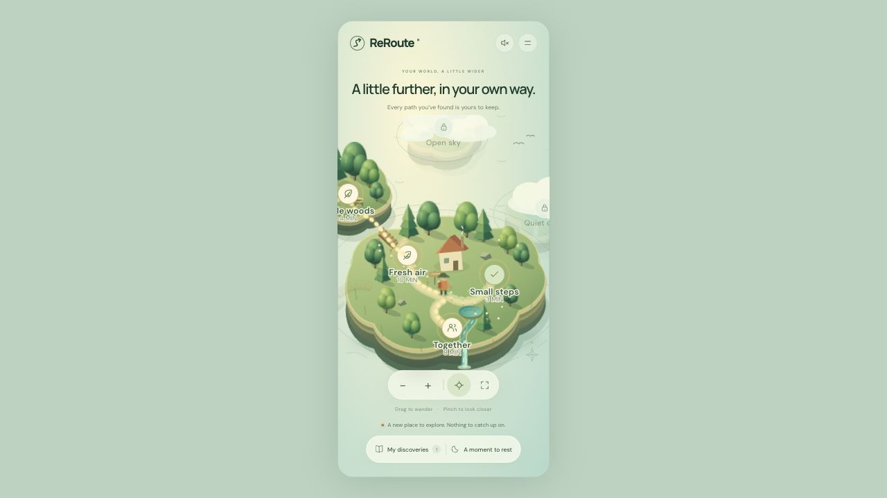

<div align="center">

# ReRoute

### A small step. A new path. A world that grows with you.

A mobile-first wellbeing prototype that turns everyday movement into a tiny living island—and helps people find another way when life interrupts their plans.

**Future Health Digital Innovation Challenge · Wellbeing · Challenge 09: Sustaining Healthy Behaviors**

[Hosted prototype](https://reroute-island-mk.equalbox1.chatgpt.site) · [Run locally](#run-locally) · [Demo walkthrough](#a-three-minute-demo) · [Challenge brief](https://hack2skill.com/event/futurehealthchallenge/)



</div>

> **Prototype status:** Working browser experience with predefined activities, local progress, and simulated demo days. No clinical validation, measured health outcomes, AI personalization, or wearable integration is claimed. The hosted prototype currently has restricted access; running locally is the reproducible review path.

## The idea

A healthy intention can be easy to abandon when a meeting runs late, the weather changes, or energy drops. ReRoute makes that moment part of the experience.

Choose a glowing path for a small movement break. If circumstances change, tap **Plans changed** and choose a feasible detour. Completing the action reveals a piece of your island; taking a detour can uncover a bridge. Rest leaves every discovery intact.

**The central product hypothesis:** helping someone adapt an intention after a setback may be more useful for sustained behavior than rewarding an uninterrupted streak. ReRoute makes recovery visible and rewarding. That hypothesis still needs participant testing.

The intended first audience is adults who want manageable movement breaks around busy or unpredictable routines. The prototype focuses on movement; it does not attempt to cover every wellbeing behavior.

## Fit with the hackathon

The [official Challenge 09 brief](https://hack2skill.com/event/futurehealthchallenge/) asks for support that helps people initiate, sustain, and recover healthy behaviors as circumstances change. ReRoute addresses that brief through this focused loop:

**Choose → Act → Encounter a barrier → Adapt or rest → Return → Discover**

| Challenge theme | Implemented in ReRoute | Work still needed |
| --- | --- | --- |
| Feasible personal actions | Indoor, outdoor, social, short, and seated options; explicit barrier selection | Goal onboarding and reviewed health-context adaptations |
| Recovery and learning | Time, energy, weather, and space detours; discoveries survive rest | Detect lapses with consent and learn from previous choices |
| Behavior support | Small actions, immediate feedback, visible progress, and optional company | Expert review of the behavioral rationale and comparative testing |
| Autonomy and inclusion | User-chosen paths, rest, optional sound, keyboard controls, reduced motion | Arabic/RTL, accessibility audit, and broader co-design |
| Sustained outcomes | Local records of completed demo journeys | Longitudinal measurement and equitable-benefit evaluation |

This is a submission-oriented prototype, not evidence of registration, acceptance, or endorsement. The official page lists prototype submission on **20 November 2026**; verify the current rules and dates before submission. Brief checked **24 October 2026**.

## What makes the experience distinctive

- **The island is the interface.** Tap paths directly instead of navigating a dashboard of charts and tasks.
- **Setbacks open possibilities.** A detour is a valid continuation and can reveal a new bridge.
- **Progress stays.** Rest does not erase discoveries; there is no streak-reset mechanic.
- **A world with atmosphere.** Layered cliffs, shaded trees, swaying foliage, streams, waterfalls, and clearing mist make progress tangible.
- **Direct exploration.** Drag, pinch, or scroll to explore. The camera follows the walking character and frames newly revealed areas; manual exploration pauses follow.

These describe the implemented design, not a claim of market uniqueness or proven effectiveness.

## A three-minute demo

1. Open ReRoute and tap **Fresh air** or **Small steps**. Watch the character follow the curved path before the activity sheet opens.
2. Choose **Let’s go** to start the timer. The activity happens away from the screen.
3. Tap **Plans changed**, then **Time got away** or **Low on energy**. Read the shorter alternative and why it fits.
4. Start that detour and choose **Preview completion**. This explicitly simulates completion; it does not measure activity.
5. Watch the camera frame the new area as mist clears. A first completed detour also reveals the bridge.
6. Use **Keep exploring the demo** or the island menu to begin another demo day. Further completed journeys reveal the cove and summit.
7. Try **A moment to rest**. Previous discoveries remain available.

One journey can be completed per **demo day**. Days advance manually; this is not yet a calendar-based habit tracker. **Together** suggests asking someone nearby—it does not send invitations or connect accounts.

## Run locally

Requirements: Git and Python 3. No package installation, build step, API key, or account is required to run the application.

```sh
git clone https://github.com/mk-tdev/reroute.git
cd reroute
python3 -m http.server 4173 --bind 127.0.0.1 --directory dist
```

Open **http://127.0.0.1:4173**. Stop the server with `Ctrl+C`.

For access-controlled repositories, authenticate with GitHub first. To review on a physical phone, serve on your local network using an appropriate development setup; the loopback command above is accessible only on the host computer.

### Controls

| Input | Action |
| --- | --- |
| Tap a glowing path or marker | Select a movement route |
| Drag / two-finger pinch | Pan / zoom the island |
| Mouse wheel or + / − buttons | Zoom |
| Crosshair button | Resume character follow |
| Corner-frame button | Show the whole island |
| Tab, then Enter or Space | Activate a route or button |
| Arrow keys while the island is focused | Pan |
| + / − / R while the island is focused | Zoom / reset view |

## Architecture

A buildless client application: HTML, CSS, JavaScript, SVG, and browser APIs. The scenery is **illustrated 2.5D**, not a rotatable 3D mesh.

```text
dist/
  index.html       Page, island viewport, controls, and activity dialog
  app.js           Routes, detours, timers, local state, unlocks, SVG scenery
  motion.js        Curve-following character movement and mist transitions
  camera.js        Pan, pinch, zoom, follow, and reveal framing
  style.css        Responsive layout, lighting, scenery, and accessibility styles
tests/
  camera.test.cjs   Gesture geometry and camera behavior
  motion.test.cjs   Path sampling and movement lifecycle
.openai/
  hosting.json     Existing Sites deployment configuration (not a credential)
```

The app selects from fixed route and detour definitions. Progress is stored in browser `localStorage` under `reroute-world-v2`. Character movement samples SVG curves by arc length; camera movement changes the SVG viewBox. CSS and Web Animations drive scenery and mist. Static hosting can serve `dist/` directly; publishing this GitHub repository does not automatically redeploy the existing hosted Site.

## Verification

With a modern Node.js installation that supports `node:test`:

```sh
node --test tests/*.test.cjs
node --check dist/app.js
node --check dist/camera.js
node --check dist/motion.js
```

The 10 existing tests cover curved movement, rapid retaps, cancellation, reduced-motion travel, background settling, drag-versus-tap behavior, pinch anchoring, follow controls, and zoom bounds. These are logic tests using mocked browser objects, not end-to-end tests on physical devices.

Phone-sized browser previews were used to check layout, path interactions, camera controls, and mist reveals. Physical-device performance, assistive-technology coverage, and sustained behavior outcomes remain unverified.

## Privacy, safety, and current limits

- No application backend, analytics pipeline, wearable connection, patient record, or health assessment is implemented. Hosting infrastructure may retain ordinary request logs.
- Local progress includes journey IDs, demo days, activity durations, simulation flags, rest days, sound preference, and timer state. It is not encrypted or synchronized. Clearing site data or resetting the demo removes it.
- Google Fonts is an external request; system-font fallbacks are available. Fully offline installation and a service worker are not implemented.
- Completions are self-reported or explicitly simulated. They are not verified exercise minutes or clinical measurements.
- Suggestions are predefined wellbeing content, not individually assessed exercise prescriptions. A production pilot needs qualified content review and clear suitability boundaries.
- No AI model runs in the product. Adding AI would require a defined benefit, evaluation, consent, and safety controls; it is not necessary for the current demonstration.
- Reduced-motion settings disable decorative animations. Background tabs pause scenery. Neither feature substitutes for a full accessibility or performance audit.

## Proposed pilot and measures

**Not yet conducted:** co-design with users and a qualified wellbeing/behavior specialist, followed by an opt-in four-week feasibility pilot. Compare the detour experience with a simple fixed-plan version if recruitment and review support that design.

Measure behavior rather than island taps:

| Measure | Proposed definition |
| --- | --- |
| Persistence | Weeks with participant-reported movement on a pre-agreed number of days |
| Recovery after a lapse | Time to the next chosen action after an agreed missed opportunity |
| Detour usefulness | Accepted detours that participants report completing |
| Behavior change | Change from baseline in reported movement days; optional consented device comparison later |
| Retention | Participants returning in weeks 2 and 4 |
| Inclusion and experience | Usability, perceived pressure, barriers, and differences across consenting participant groups |

Define denominators and missing-data handling before enrollment. Keep simulated events out of outcome analysis. Report uncertainty, dropouts, and adverse experiences alongside positive results. No pilot results are available today.

## Next milestones

1. **Submission readiness:** demo video, accessible reviewer deployment, physical-phone checks, and documented accessibility findings.
2. **A real habit loop:** calendar days, goal selection, user-controlled reminders, and explicit recovery journeys after absence.
3. **Inclusive content:** Arabic/RTL, co-designed movement alternatives, and professional review.
4. **Pilot readiness:** consent, optional outcome collection, deletion/export controls, and a pre-specified evaluation protocol.
5. **Deployment validation:** test a voluntary community or workplace wellbeing pilot, hosting costs, adoption, and willingness to pay. No employer monitoring, commercial agreement, or partner deployment exists today.

## Project ownership and references

Maintained under [mk-tdev](https://github.com/mk-tdev). No open-source license has been selected; repository availability does not grant a license to reuse the code.

- [Official Future Health Digital Innovation Challenge brief and assessment criteria](https://hack2skill.com/event/futurehealthchallenge/) — select **Wellbeing → Sustaining Healthy Behaviors**.
- [Official challenge rules](https://hack2skill.com/event/futurehealthchallenge/tnc) — authoritative source for eligibility and submission requirements.
- [Learn Arduino reference](https://learn-arduino-red.vercel.app/) — interaction inspiration for an explorable central object. ReRoute implements its island artwork and interactions in this repository.
